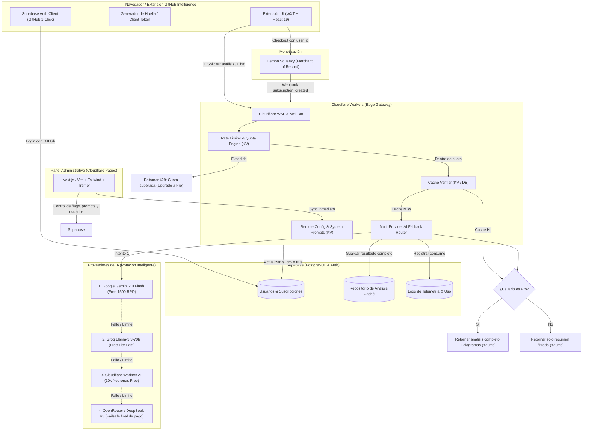

# Arquitectura de Monetización, Backend Edge & Panel de Control
**Proyecto:** GitHub Intelligence Browser Extension  
**Fecha:** 2026-11-12  
**Estado:** Documento de Diseño Final para Aprobación

---

## 1. Intención y Propósito ("The Why")
Monetizar la extensión de navegador GitHub Intelligence mediante un modelo freemium por suscripción sostenible, reduciendo el costo operativo de IA a prácticamente **$0.00 USD/mes de costo fijo base**, maximizando el margen de ganancia.

Simultáneamente se busca:
1. **Blindar la propiedad intelectual (Anti-Clonación):** Convertir la extensión en un cliente ligero (*thin client*), trasladando toda la heurística, prompts, lógica de análisis de repositorios y orquestación con IA al backend. Si alguien descomprime o clona la extensión, solo encontrará una interfaz visual y llamadas a la API protegida.
2. **Reemplazar heurísticas y traducciones literales por comprensión real con IA:** Brindar resúmenes inteligentes ("qué hace realmente el proyecto", "por qué importa", "audiencia objetivo", stack técnico) y soporte interactivo con una mascota conversacional flotante.
3. **Control anti-abuso robusto para usuarios gratuitos:** Permitir 15 consultas diarias sin registro para maximizar la conversión inicial, pero bloqueando abusos de VPN, reseteo de cookies o cambios de navegador mediante huella de dispositivo y limitación en el Edge.
4. **Cobros globales con recepción en Perú:** Uso de **Lemon Squeezy** como Merchant of Record (MoR), evitando la necesidad de constituir una LLC en EE.UU. requerida por Stripe.
5. **Panel de Control Administrativo integral:** Para controlar dinámicamente funcionalidades, prompts, cuotas, proveedores de IA, usuarios y telemetría sin depender de actualizaciones en la Chrome Web Store.

---

## 2. Metas, No-Metas y Anti-Metas

### Metas (Goals)
* **Arquitectura Thin-Client:** La extensión no contiene API keys ni prompts propietarios; solo consume la API Edge con tokens de autenticación o firmas anónimas.
* **Alcance de Repositorios Públicos (V1):** Ingestión eficiente mediante `raw.githubusercontent.com` sin consumir límites de API de GitHub y habilitando un caché global 100% compartido sin riesgos de fuga de privacidad.
* **Margen de Ganancia Óptimo:** Caché jerárquico (`owner/repo:commit_sha`) en Cloudflare KV / PostgreSQL para que los repositorios populares tengan 0 tokens consumidos y respuesta <25ms.
* **Generación Completa en 1 Solo Paso:** Al analizar un repositorio por primera vez, la IA genera el paquete completo (resumen + diagramas Pro). Quien es Free recibe solo el resumen filtrado por el backend; si un Pro lo visita después, recibe los diagramas al instante con 0 tokens adicionales.
* **AI Fallback Layer Multi-Proveedor:** Enrutador inteligente con rotación y contingencia:
  1. *Google Gemini 2.0 Flash Free Tier* (15 RPM / 1,500 RPD gratuitos)
  2. *Groq Cloud Free Tier* (Llama 3.3 70B / 8B, ultrarrápido y sin costo)
  3. *Cloudflare Workers AI* (10,000 neuronas diarias gratuitas)
  4. *OpenRouter / DeepSeek V3* (contingencia de pago a fracciones de centavo por millón de tokens).
* **Integración Lemon Squeezy con Pre-Autenticación:** Login previo en 1 clic con GitHub (Supabase Auth). Checkout con `custom_data: { user_id }` y activación automática e instantánea vía Webhooks.
* **Bolsa Unificada de 250 Consultas Pro:** Tanto el análisis de repositorios como las preguntas en el chat con la mascota descuentan de una misma bolsa diaria de 250 unidades.
* **Panel Administrativo Completo:** Métricas en vivo, gestión de usuarios, edición de prompts en caliente, monitor de salud de proveedores de IA y explorador de caché. Sincronización automática de configs a Cloudflare KV para latencia <15ms.

### No-Metas (Non-Goals)
* No se ejecutarán modelos de IA localmente en el navegador (WebLLM/ONNX).
* No se requiere registro obligatorio para el plan gratuito en el primer contacto.
* No se dará soporte a repositorios privados en la versión de lanzamiento inicial (planificado para v2 con OAuth de GitHub con `repo` scope y caché aislado por usuario).

### Anti-Metas (Anti-Goals)
* **Nunca exponer API keys de IA** ni tokens de infraestructura en el bundle de la extensión.
* **Evitar costos fijos de servidor (No VPS obligatorio):** Todo debe correr bajo el nivel gratuito de Cloudflare Workers, Cloudflare Pages y Supabase mientras se valida el producto.
* **No permitir sobrecostos descontrolados:** Límites de presupuesto diario en APIs de pago y circuit breakers automáticos.

---

## 3. Enfoque Arquitectónico Seleccionado: Edge-First Híbrido

* **API Pública & IA Gateway:** Cloudflare Workers (TypeScript) en el Edge global.
* **Base de Datos & Auth:** Supabase (PostgreSQL para usuarios, suscripciones y caché relacional + Supabase Auth con GitHub).
* **Caché ultrarrápido & Rate Limiting:** Cloudflare KV (límite de 15/día y respuestas en <15 ms).
* **Panel Admin:** Aplicación web (Next.js / Vite + Tailwind + Tremor) alojada gratis en Cloudflare Pages.
* **Pagos:** Lemon Squeezy (MoR con soporte directo de transferencias a Perú).
* **Costo mensual base:** **$0.00 USD/mes**.

---

## 4. Diagrama de Arquitectura y Flujo



---

## 5. Especificaciones Detalladas de Componentes

### 5.1 Extensión (Cliente Ligero)
* **Responsabilidades del Frontend:**
  * Detectar URL del repositorio (`github.com/:owner/:repo`) y obtener el último commit SHA desde el DOM o encabezado.
  * Enviar request a `https://api.tu-dominio.com/v1/analyze` con:
    * `owner`, `repo`, `commit_sha`.
    * Cabecera `X-Client-Signature` (hash de IP + Canvas fingerprint) para Free, o `Authorization: Bearer <JWT>` para Pro.
  * Renderizar los datos devueltos:
    * **Vista Free:** Resumen conversacional breve, para qué sirve, por qué importa, stack principal.
    * **Vista Pro:** Todo lo anterior + Diagrama de arquitectura interactivo (Mermaid.js) + Auditoría técnica + Widget flotante de la mascota para chatear sobre el repo.
* **Onboarding & Requisito Pro:** 
  * Botón "Mejorar a Pro ($4.99)" $\rightarrow$ ejecuta `supabase.auth.signInWithOAuth({ provider: 'github' })` $\rightarrow$ tras recibir sesión abre checkout de Lemon Squeezy pasando `custom_data: { user_id: session.user.id }`.
  * **GitHub Personal Access Token (PAT):** Al usuario Pro se le solicita ingresar su token personal de GitHub en la extensión (almacenado 100% en local en `chrome.storage.local`), presentado de forma natural y transparente simplemente como **requisito indispensable de funcionamiento** para desbloquear la inspección profunda de árboles, dependencias y metadatos de GitHub sin explicaciones innecesarias de límites de cuotas.

### 5.2 Cloudflare Workers (Edge Gateway & AI Router)
* **Ruta `/v1/analyze` (POST):**
  1. **Quota Check:** 
     * Si viene JWT: Valida en Supabase o firma local. Descuenta de `quota:pro:<user_id>:<date>` (máx 250/día).
     * Si es anónimo: Valida `quota:anon:<sha256(ip+fingerprint)>:<date>` (máx 15/día). Si excede, retorna HTTP 429 con mensaje motivando a la suscripción.
  2. **Cache Check:**
     * Consulta `cache:repo:<owner>:<repo>:<commit_sha>`.
     * Si existe, responde de inmediato aplicando el filtro de nivel (si no es Pro, remueve las llaves `architectureDiagram` y `deepAudit`).
  3. **Ingestión de Contenido:**
     * Descarga `https://raw.githubusercontent.com/:owner/:repo/:commit_sha/README.md` y archivos de manifiesto (`package.json`, `Cargo.toml`, `go.mod`, etc.).
  4. **Generación con IA (Cache Miss):**
     * Envía prompt optimizado estructurado en JSON a la cadena de proveedores (Gemini $\rightarrow$ Groq $\rightarrow$ Cloudflare AI $\rightarrow$ OpenRouter).
     * Almacena el JSON resultante completo en Cloudflare KV y Supabase `repo_analyses`.
     * Retorna respuesta filtrada según el rol del solicitante.
* **Ruta `/v1/mascot/chat` (POST - Exclusiva Pro):**
  * Descuenta 1 crédito de la bolsa diaria de 250.
  * Envía el historial de mensajes + el resumen del repositorio como contexto de sistema al modelo ultrarrápido (Groq Llama 3.3 70B o Gemini Flash).
  * Retorna respuesta mediante Server-Sent Events (SSE) para renderizado fluido en el chat de la mascota.
* **Ruta `/v1/webhooks/lemonsqueezy` (POST):**
  * Valida firma HMAC con el secreto de webhook de Lemon Squeezy.
  * Eventos gestionados:
    * `subscription_created` / `subscription_resumed`: `profiles.is_pro = true`.
    * `subscription_cancelled` / `subscription_expired`: `profiles.is_pro = false`.
* **Ruta `/v1/config` (GET):**
  * Retorna desde Cloudflare KV las feature flags públicas (ej. versión mínima, banners informativos, estado de mantenimiento).

### 5.3 Panel de Administración (Cloudflare Pages + Next.js / React)
Acceso protegido exclusivamente para usuarios con `profiles.role = 'admin'`.

1. **Dashboard & Telemetría:**
   * Gráficas en tiempo real de consultas por día (Free vs Pro).
   * Ratio de aciertos de caché (eficiencia objetivo: >75%).
   * Distribución de llamadas a proveedores de IA (cuántas resolvió Gemini, cuántas Groq, etc.).
2. **Editor de Prompts & Personalidad:**
   * Editor en vivo para el *System Prompt* de análisis de repositorios.
   * Editor para la personalidad, tono y límites de la mascota asistente.
   * Botón de guardado que actualiza Supabase y replica a Cloudflare KV en <1 segundo.
3. **Gestor de Feature Flags & Cuotas:**
   * Sliders para cambiar cuotas globales (ej. cambiar límite Free de 15 a 10 o Pro de 250 a 300) sin tocar código.
   * Toggles para activar/desactivar la mascota, diagramas o forzar modo mantenimiento.
4. **Gestión de Proveedores de IA:**
   * Reordenar la lista de prioridad con arrastrar y soltar.
   * Indicador visual de estado de salud (latencia media y % de errores de cada API).
5. **Explorador & Purga de Caché:**
   * Búsqueda por nombre de repositorio.
   * Opción para ver el JSON analizado o forzar borrado para re-análisis inmediato.
6. **Gestión de Usuarios:**
   * Búsqueda por email o ID de GitHub.
   * Switch para otorgar/revocar membresía Pro manualmente (cortesía para testers/socios).
   * Historial de eventos de suscripción de Lemon Squeezy.

---

## 6. Esquema de Base de Datos (Supabase PostgreSQL)

```sql
-- Perfiles de usuario vinculados a Supabase Auth
create table profiles (
  id uuid references auth.users on delete cascade primary key,
  email text not null,
  role text default 'user' check (role in ('user', 'admin')),
  lemon_customer_id text,
  is_pro boolean default false,
  created_at timestamptz default now()
);

-- Suscripciones de Lemon Squeezy
create table subscriptions (
  id uuid default gen_random_uuid() primary key,
  user_id uuid references profiles(id) on delete cascade,
  lemon_subscription_id text unique not null,
  status text not null, -- 'active', 'past_due', 'cancelled', 'expired'
  variant_id text,
  current_period_end timestamptz,
  created_at timestamptz default now(),
  updated_at timestamptz default now()
);

-- Caché global de análisis de repositorios
create table repo_analyses (
  id uuid default gen_random_uuid() primary key,
  repo_full_name text not null, -- 'owner/repo'
  commit_sha text not null,
  summary_json jsonb not null,
  architecture_diagram text,
  primary_language text,
  provider_used text,
  tokens_consumed integer default 0,
  created_at timestamptz default now(),
  constraint uq_repo_commit unique (repo_full_name, commit_sha)
);
create index idx_repo_commit on repo_analyses(repo_full_name, commit_sha);

-- Telemetría y logs de consultas
create table query_logs (
  id uuid default gen_random_uuid() primary key,
  user_id uuid references profiles(id) on delete set null,
  client_fingerprint text,
  ip_hash text not null,
  repo_full_name text not null,
  is_pro boolean default false,
  cache_hit boolean default false,
  provider text,
  action_type text default 'analysis' check (action_type in ('analysis', 'mascot_chat')),
  response_time_ms integer,
  created_at timestamptz default now()
);

-- Configuración Remota & Prompts (Sincronizado a Cloudflare KV)
create table remote_configs (
  key text primary key,
  value jsonb not null,
  description text,
  updated_at timestamptz default now()
);
```

---

## 7. Fases de Implementación Sugeridas
1. **Fase 1: Infraestructura Base & Edge Gateway:** Creación del proyecto Cloudflare Workers con el enrutador multi-proveedor de IA (Gemini + Groq + Cloudflare AI) y sistema de caché en KV.
2. **Fase 2: Base de Datos & Webhooks Lemon Squeezy:** Configuración del proyecto Supabase, tablas, Auth con GitHub y endpoint de webhooks para Lemon Squeezy.
3. **Fase 3: Adaptación de la Extensión (Thin Client):** Migración de `spanishSummary.ts` y componentes para consumir la API Edge, soporte de inicio de sesión con GitHub y renderizado Pro.
4. **Fase 4: Panel de Administración:** Construcción del panel en Cloudflare Pages con Tailwind para control de flags, prompts, usuarios y métricas.
5. **Fase 5: Mascota Flotante y Chat Interactivo:** Integración de la mascota en el DOM de GitHub y conexión con `/v1/mascot/chat` mediante SSE.
